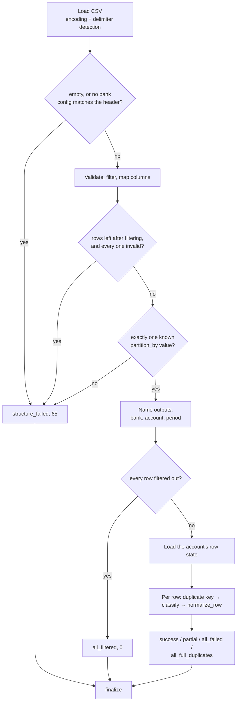
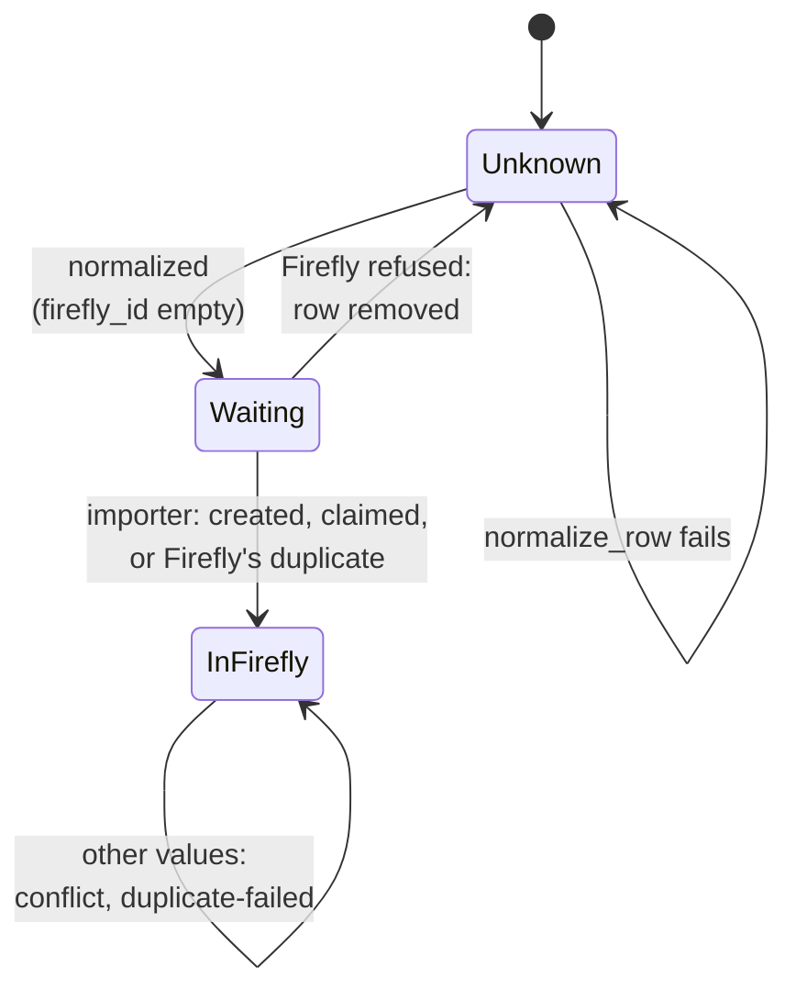
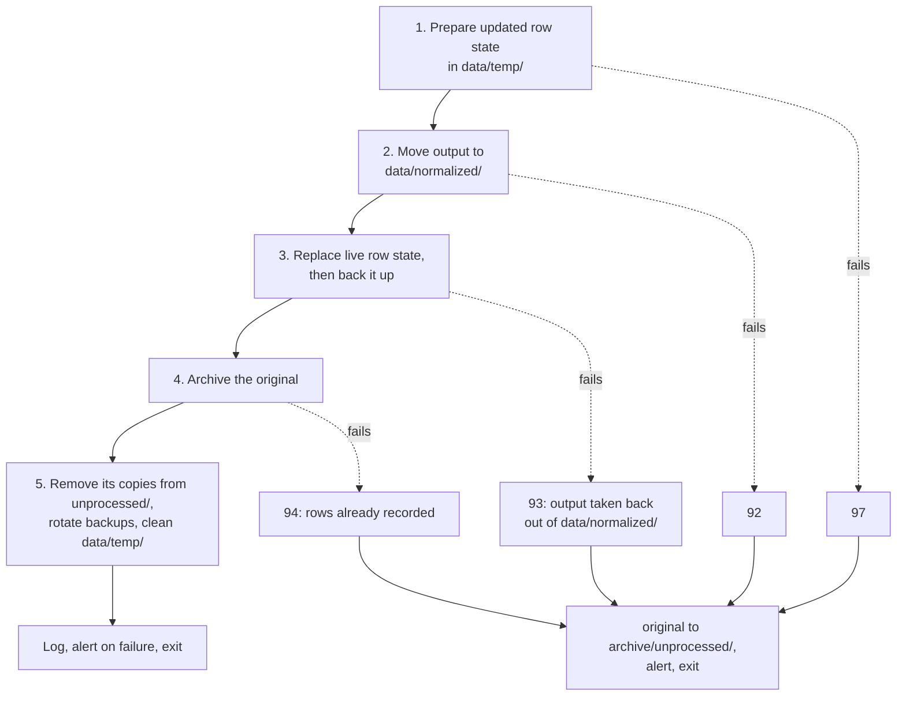

---
paths:
  - engine/**
  - config/**
  - firefly-iii-feeder.bash
---

# Architectural Patterns

## 1. Linear Multi-Phase Pipeline

[engine/process_csv.py](../../engine/process_csv.py) `main()` runs one bank file through a strict
ordered sequence; every way out goes through `finalize` (§2).



| Step | Where |
|---|---|
| Load | `load_csv_rows` in [engine/core/csv_runtime.py](../../engine/core/csv_runtime.py) |
| Bank | `autodetect_bank` in [engine/core/csv_validation.py](../../engine/core/csv_validation.py): every required column of exactly one config present |
| Validate | `validate_and_prepare`: `filter` / `filter_regex` drop a row (counted per reason in the log); a failing `regex` marks it, and the loop sends it to normalize-failed |
| Name outputs | `describe_output`, `archive_paths` (§10) |
| Row state | `load_row_state` in [engine/core/row_state.py](../../engine/core/row_state.py) (§7) |
| Per row | `extract_duplicate_key` (no key → duplicate-failed), `classify_duplicate`, the bank's `normalize_row` (exception → normalize-failed), write temp output |

An exception anywhere is `error`, exit 99.

## 2. Single Exit Path (`completion.finalize`)

`finalize()` is the **only** place that calls `sys.exit()` (apart from the argument check at the
top of `main()`). Every code path calls it, so the output move, row-state commit, archiving of the
original, cleanup and the failure alert always happen together. Order and criticality: §8; where
the original goes: [docs/archive-and-reload.md](../../docs/archive-and-reload.md).

## 3. Configuration-Driven Bank Support

Bank-specific behaviour lives in `config/<bank>.yaml` and
`engine/banks/<bank>/`. `engine/core/` has zero hardcoded bank names. Key YAML sections (see [config/fintro.yaml](../../config/fintro.yaml)):

- `columns.required` — expected headers with `names` (aliases), `regex`
  (per-cell validation), `filter` (exact-match allowlist), `filter_regex`.
- `columns.optional` — headers included when present, ignored when absent.
- `duplicate_key.columns` / `duplicate_key.regex` — how to extract the dedup
  key from a row.
- `duplicate_key.partition_by` — internal column whose value names the
  account: its row-state file (`<VALUE>.csv`) and the first part of `row_key`.
  Falls back to the bank name if absent.

Bank name is derived from the YAML filename and injected as `cfg["bank"]` by
`load_all_bank_configs` in [engine/core/csv_runtime.py](../../engine/core/csv_runtime.py).
The normalizer module is loaded dynamically by `process_csv.py` via
`importlib.import_module(f"engine.banks.{bank_name}")`.

## 4. Lazy Writer Pattern

CSV writers are never opened speculatively. Each output file
(`temp_normalized`, `failed_normalize`, `failed_duplicate`) holds a
`{"writer": None, "file": None}` ref dict. `ensure_writer()` in
[engine/core/csv_runtime.py](../../engine/core/csv_runtime.py) creates the file +
writer on first use and writes the header once.

All refs are collected in `context["open_writers"]` for guaranteed cleanup by
`close_open_writers()` in [engine/core/completion.py](../../engine/core/completion.py).

## 5. Two-Source Data Reconciliation

When a bank states the same fact twice (a dedicated column and a free-text
field), its module compares both and either merges them or raises `ValueError`
on a mismatch — neither source is blindly trusted. Which source wins per field
is bank-specific and documented in the bank's README (Fintro:
[engine/banks/fintro/README.md](../../engine/banks/fintro/README.md), "Two sources").
Both follow the normalization principle in AGENTS.md: nothing meaningful is lost.

## 6. Two-Phase `normalize_row` + Sequential Free-Text Parsing

A bank's `normalize_row()` is split into two explicit phases:

**Phase 1 — Extraction.** Pull all values into named variables; no output is
written yet: dedicated columns by key from `csv_row`, then the free-text field.
Free text is parsed sequentially and destructively: each matched segment is
cut from the remaining text, so a later pattern cannot match it again, and
anything left at the end raises `ValueError`.

**Phase 2 — Reconcile, reformat, assemble.** No parsing at this stage; only
cross-source decisions, cosmetic replacement, and final assembly of the
`NORMALIZED_FIELDNAMES` defined in [engine/process_csv.py](../../engine/process_csv.py)
(all but `row_key`, which `process_csv` adds).

The patterns and their order are bank-specific: see the bank's README (Fintro:
"Parsing `Details`").

## 7. Row State: Dedup Plus Firefly Id

[engine/core/row_state.py](../../engine/core/row_state.py). One CSV per account,
`data/row-state/<account>.csv` (`<account>` = the `duplicate_key.partition_by`
value, else the bank name; the same as the first part of `row_key`), with
`duplicate_key`, `firefly_id` and the `columns.required` values of every bank row
the feeder knows.



Unknown = not in the file; Waiting = recorded, its output waits in `data/normalized/`.

- **The normalizer** loads the state at the start of each file and classifies each row
  (`classify_duplicate`): `new` (key not seen), `identical` (all required fields match → skipped,
  also while Waiting), `conflict` (fields differ → duplicate-failed, state unchanged). Rows enter
  only after `normalize_row` succeeded, so a failed row is retried when its CSV comes again; they
  are added to the in-memory state during the loop, so duplicates within one file are caught too.
  `finalize` commits them only for `success` / `partial`.
- **The importer** (`record_import`, per file, before the file moves) fills `firefly_id`, or
  removes a row Firefly refused so the next export holding it retries it. A row whose `firefly_id`
  is set is never sent again. Transfer sides used by a recorded row are never claimed again (§13).
- **Changed `columns.required`**: the next commit rewrites the state with the new columns
  (logged): a removed column is dropped, an added one is `<not recorded>` (`NOT_RECORDED`) for the
  old rows and skipped when comparing them, so no re-import is needed.

Commit (`finalize` step 3): the updated state is prepared in `data/temp/`
(`create_updated_row_state`), replaces the live file atomically (temp file + `os.replace`,
`copy_atomically`), then a copy goes to `backups/<run>-<account>.csv` (`rotate_backups`, per
account: at most `MAX_BACKUPS=50`, none older than `MAX_BACKUP_AGE_DAYS=365`, newest always kept).
The importer replaces the file the same way, without a backup.

## 8. Finalize Order and Tiered Error Criticality

`finalize()` in [engine/core/completion.py](../../engine/core/completion.py) first renames the log
`<run>.log` to its final name and closes the writers, then:



- **Critical** (steps 1–4): compensate, alert, exit. The original goes to `archive/unprocessed/`,
  so it is not retried every minute and can be dropped in again. At 93 the importer has not seen
  the output yet: it runs only after every bank file. At 94, dropped in again, every row is
  `identical` and the original is archived.
- **Non-critical** (step 5, the backup copy, logging): try/except, log, continue.
- **Catastrophic** (exit 99): unhandled exception anywhere in the pipeline.

Until step 4 the original stays in `data/incoming/`, so a run interrupted hard (reboot, kill) is
redone by the next one:

| Interrupted | Next run |
|---|---|
| before step 2 | everything again, nothing twice |
| after step 2 | the output exists twice; the importer sends each row once (the second copy finds its `firefly_id`) |
| after step 3 | every row `identical`; the original is archived |

## 9. Context Dict as Pipeline State

A single `context` dict is threaded through all phases and into `finalize()`.
It carries `paths`, `open_writers`, `row_state_rows_to_add`,
`log_event`, and the run id. This avoids module-global state while
keeping the pipeline callable as a unit — see `main()` in
[engine/process_csv.py](../../engine/process_csv.py).

## 10. Content-Describing File Names

Every file of one bank file in `data/` — normalized output, failed rows, logs, import outputs —
is named `<base>-<stage>` (format: AGENTS.md "Key Directories"). All files of one bank file sort
together, and a name says what is in it; this gives a complete audit trail without a database.

- **Unique by construction**: `<run>` = start of the cron run (`YYYYMMDD-HHMMSS`, parsed back as
  `RUN_TS_FORMAT` in [engine/core/row_state.py](../../engine/core/row_state.py)) + the file's
  number in that run, generated by [firefly-iii-feeder.bash](../../firefly-iii-feeder.bash) with
  builtins. A run starting in a second already used by an earlier run leaves the work to the next
  minute.
- **Python names, bash only numbers**: `build_paths` in
  [engine/core/csv_runtime.py](../../engine/core/csv_runtime.py) starts with
  `<run>-unknown-<source name>`; once bank, account and period are known (before the row loop)
  `process_csv` sets the final names, and `finalize` renames the log `<run>.log` that bash created.
  The source name is on the log's first line.
- **The importer** derives its names (`-imported`, `-import.log`, `-import-failed`) from the
  normalized file, so they follow automatically.
- **The archived original** keeps the run id of its first arrival (`ARRIVAL_RUN_ID`, in
  `csv_runtime` and in bash), so a reload processes the originals in the order they first arrived.
  Names: [docs/archive-and-reload.md](../../docs/archive-and-reload.md).

## 11. Cron-Safe Orchestration

[firefly-iii-feeder.bash](../../firefly-iii-feeder.bash) guards unattended execution:

- **Idle runs** exit first, with builtins only (AGENTS.md "Idle cost"); every other step comes
  after that exit.
- Sets `PYTHONPATH` and `cd`s into `BASE_DIR` (cron has no defaults).
- Exclusive `flock` on `.process.lock` for the whole run (normalizer, importer, archive commit);
  a second instance exits at once, and the kernel drops the lock when the process dies, so a crash
  or reboot cannot leave a stale lock. `start-over.bash` takes the same lock.
- **Upload check** — skip a file until its `ctime` is ≥ 30 s old (`UPLOAD_SETTLE_SECONDS`;
  Explorer and `cp -p` keep an old mtime, but every write bumps ctime) and its last byte is a
  newline; after 10 min process anyway, so a broken file gets reported.
- Exit codes `0/65/75/99` are "Python handled it"; anything else triggers a fallback move of the
  incoming file to `archive/unprocessed/`, unless that folder already holds its content.
- After every bank file, the importer (§13); then the archive is committed and pushed
  ([docs/archive-and-reload.md](../../docs/archive-and-reload.md), rule 7).
- Alerts go to stderr, which the TrueNAS cron job emails. Success is silent.

State that must survive a run is a flag file in `data/`:

| Flag | Set by | Removed when | While it exists |
|---|---|---|---|
| `firefly-recalculate.flag` | importer, before the first batch row | `batch/finish` and the running balances both succeeded | counts as work: every minute retries the follow-up |
| `firefly-follow-up-alerted.flag` | the first failed follow-up | together with the flag above | the retries stay silent |
| `firefly-import-blocked.flag` | Firefly unreachable or token refused (exit 69) | a run that is not blocked | one alert per outage |
| `firefly-import-crashed.flag` | unexpected exception in the importer (exit 70) | a run that does not crash | one alert, with the traceback |
| `archive-push-pending.flag` | bash or `start-over.bash`, push failed | a push succeeded | counts as work: every minute pushes again; one alert |

## 12. Naming Conventions

All code uses explicit, descriptive English names. Related values share
prefixes to make the origin obvious in reconciliation blocks —
`column_*` for values pulled from dedicated CSV columns, `details_*` for
values extracted from the free-text `details` column, `normalized_*` for
final output fields. Names reflect meaning and purpose; no abbreviations
except common ones (IBAN, BIC, CSV).

## 13. Firefly III Import Stage

[engine/firefly/import_normalized.py](../../engine/firefly/import_normalized.py) runs after every
bank file of the run and turns each row in `data/normalized/` into one `POST /api/v1/transactions`
with `error_if_duplicate_hash`: Firefly answers a row it already stored with 422 "Duplicate of
transaction #id", counted as already present. Firefly gotchas: AGENTS.md "Firefly III Import".

- **Firefly state read per run** — asset accounts by IBAN and account number, currencies,
  existing transfers. Nothing about Firefly is configured in this repo.
- **Row → split** (`build_split`; field table: [docs/output-contract.md](../../docs/output-contract.md),
  "In Firefly"):
  - The sign of `amount` decides withdrawal / deposit. The own account is `asset_account_iban`,
    else `asset_account_number`, matched against both fields of every Firefly asset account. No
    match, an identifier of two accounts, or a counterparty that is the row's own account fails
    the row.
  - A counterparty account without an IBAN goes to `source_number` / `destination_number`: Firefly
    validates `*_iban` as an IBAN, `*_number` is free text.
  - A currency disabled in Firefly is enabled (logged); one Firefly doesn't know fails the row.
  - No counterparty → `(onbekend)`, or Firefly's Cash account for a row the bank module marked
    `is_cash_withdrawal` (`1`); a new bank only has to set that mark.
- **Own transfers: match or create** (`claim_transfer`). A row whose counterparty is an own
  account first claims an existing transfer between the same accounts, same amount, within
  `TRANSFER_MATCH_DAYS`, whose side (out or in) is still free; else it creates one. Order and
  history coverage of the accounts' CSVs don't matter. The transfer carries only the first side's
  fields; the claiming side's `external_id`, `row_key` and notes stay in its `data/imported/` file.

  ```mermaid
  sequenceDiagram
      participant A as row of account A
      participant I as importer
      participant F as Firefly
      participant S as row state
      A->>I: counterparty: own account B
      I->>F: transfer A→B, same amount, ±7 days,<br/>out side free?
      F-->>I: none
      I->>F: POST transfer
      F-->>I: id 42
      I->>S: A's row: firefly_id 42
      Note over A,S: later file or later run
      I->>F: B's row: transfer A→B,<br/>in side free?
      F-->>I: 42
      I->>S: B's row: firefly_id 42
  ```

  A side is used when a row of that account has the transfer as `firefly_id`
  (`load_transfer_pool`), so each side is claimed once, ever.
- **Mode per run**, by `BATCH_OLD_ROWS_THRESHOLD` / `BATCH_OLD_ROW_AGE_DAYS` (more than 20 rows
  older than about 6 months, relative to the day of the run):
  - **Per row** (default): Firefly applies rules and recalculates every later balance of the
    account at once: ~0.3 s for a recent row, ~3 s for a 2015 row. So `import_file` sends each file
    oldest first (banks export newest first; newest first roughly doubles the time of a few
    hundred rows). Failures are reported in file order.
  - **Batch** (history imports): ~0.2 s per row with `batch_submission`, then a follow-up at the
    end of the run: `batch/finish` applies the rules (own long timeout: slow is not an outage),
    and the root helper (AGENTS.md "Root helper") recalculates all running balances, ~1 min at
    14,500 transactions; Firefly has no API for that. `firefly-recalculate.flag` (§11) keeps the
    follow-up pending until both succeeded, also when there are no new files.
- **Run-level vs row-level failure** — Firefly unreachable or the token refused
  (`FireflyUnavailableError` / `FireflyAuthError`,
  [engine/firefly/api.py](../../engine/firefly/api.py)) stops the run, exit 69; files stay in
  place. A 5xx on a POST is first checked with `GET about` (`firefly_answers`): if Firefly answers,
  the row is the problem and fails like any rejection, so one row cannot block every run; the third
  such row in a row (`ROW_5XX_OUTAGE_STREAK`, counted across the run's files) is an outage after
  all. A rejected row goes to `data/failed-rows/<base>-import-failed.csv` and leaves the row state
  (§7); its file moves to `data/imported/` as `-imported-partial`, as does a file the normalizer
  already marked `-normalized-partial`. Any other exception (a bug) leaves the files in place,
  exit 70.
- **Dry run** — `--dry-run` runs the same decisions (including simulated transfer claims) without
  sending, moving or recording anything.
